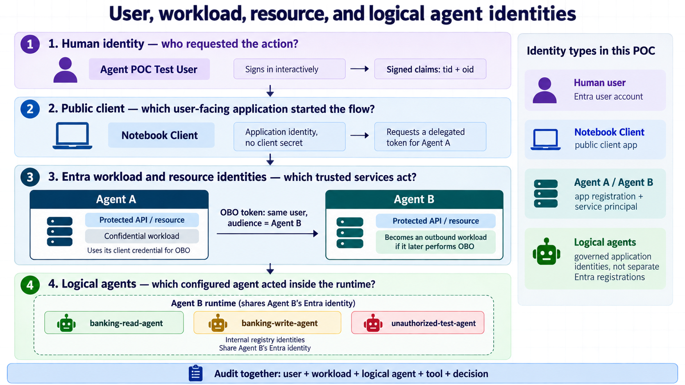

# Architecture

## Scope

This document defines a target architecture to test. It does not certify component support or interoperability.

## Context and trust boundaries

```text
┌────────────────────────── Mac host ──────────────────────────┐
│ Jupyter Notebook                                            │
│   │ user access token                                       │
│   ▼                                                         │
│ Solo agentgateway API edge                                  │
│   │ northbound validation and routing                       │
│   ▼                                                         │
│ Agent A (Google ADK) ── local API ── Ollama                 │
│   │ delegated request / application-code OBO                │
│   ▼                                                         │
│ Solo agentgateway A2A boundary                              │
│   │ A2A token validation and routing                        │
│   ▼                                                         │
│ Agent B (Google ADK) ── local API ── Ollama                 │
│   │ MCP tool request                                         │
│   ▼                                                         │
│ Solo agentgateway MCP boundary                              │
│   │ tool authorization and routing                          │
│   ▼                                                         │
│ local MCP banking mock server (read/write)                   │
└───┼──────────────────────────────────────────────────────────┘
    │ host.docker.internal whenever a container calls the host
┌───▼──────────────────── Docker Desktop ──────────────────────┐
│ All Solo gateway instances run as separate configured edges │
│ API edge, A2A boundary, and MCP boundary                    │
└──────────────────────────────────────────────────────────────┘
```

Logical flow for the active Solo POC path:

1. The notebook obtains a test-user access token intended for the API exposed through the Solo agentgateway API edge.
2. The Solo API edge validates the token and routes only an accepted request to Agent A.
3. Agent A performs local reasoning through Ollama and decides whether to delegate.
4. Agent A performs the Entra OBO exchange in application code, producing a delegated token intended for Agent B.
5. The Solo A2A boundary validates the delegated token and routes only authorized A2A traffic to Agent B.
6. Agent B reasons locally, then asks for a banking tool through the Solo MCP boundary.
7. The Solo MCP boundary enforces tool allowlists and authorization context before the banking mock.
8. A response returns through the same boundaries with one correlation identifier.

Kong Phase 0 remains a historical/reference path and is retained only as evidence of the earlier design decision. It is not part of the active runtime path for this primary POC direction.

## Component responsibilities

| Component | Intended responsibility | Must not be assumed |
|---|---|---|
| Notebook | Interactive test client and token acquisition trigger | Secure production client or confidential-client secret storage |
| Solo agentgateway API edge | Northbound routing, token validation, and request authorization for the public API boundary | Performing Entra login or OBO itself |
| Agent A | User-facing orchestration and delegation to B using application-code OBO | Autonomous identity, OBO correctness, or unrestricted tool access without validation |
| Ollama | Local model inference for Agent A and Agent B | Authorization decisions or prompt-injection protection |
| Solo agentgateway A2A boundary | A2A protocol validation, routing, and trust-boundary enforcement for delegated traffic | Performing OBO or replacing Agent B validation |
| Agent B | Banking-domain reasoning and MCP client behavior | Trust in unsigned upstream claims or direct database access |
| Solo agentgateway MCP boundary | Tool discovery, routing, and tool-level authorization for MCP traffic | User delegation, write authorization, or stable semantics without testing |
| Banking mock | Deterministic fake balances, transactions, and write operations | Real banking behavior, persistence guarantees, or use of real data |
| Entra ID | Test user, app registrations, consent, token issuance, and OBO support | A generic “agent identity blueprint” or support beyond documented OAuth behavior |

## Identity model to test

- One Entra tenant and one dedicated test user.
- Separate app registrations for Agent A's protected API and Agent B's protected API.
- Explicit application ID URI and delegated scopes for each protected API.
- A public-client or device-code-capable test client only if tenant policy permits it; otherwise use an approved developer-client pattern.
- Agent A performs OBO in application code; the Solo agentgateway validates and routes tokens but does not perform OBO.
- OBO must preserve the user delegation chain; it is not a replacement for app-only authorization.
- Agent B validates its own audience, issuer, signature, lifetime, tenant, and required delegated scope.
- Downstream tool permissions are derived from verified identity context and local policy, not natural-language claims.
- The Solo API edge, A2A boundary, and MCP boundary are configured as separate trust and policy boundaries.

See [entra-identity.md](entra-identity.md) for registration details and unresolved questions.

## Authorization model

Use deny-by-default policy at every boundary:

- Solo API edge: accepted issuer/tenant, exact audience, required user scope, supported algorithm, valid lifetime.
- Solo A2A boundary: authenticated caller, allowed target agent, allowed task/operation, bounded payload.
- Agent B: downstream token checks repeated; never trust gateway headers without a protected trust mechanism.
- Solo MCP boundary: explicit read/write tool allowlists, user and caller context, schema limits, and confirmation/idempotency for writes.
- Banking mock: server-side authorization check even if the gateway already checked.

## Observability and evidence

Generate one opaque correlation ID at the edge and propagate it through all hops. Logs may include tenant, subject hash, client/app ID, audience result, scope decision, route, tool name, result class, and timing. Logs must not include tokens, secrets, raw authorization headers, or sensitive banking payloads.

Keep redacted proof in `evidence/` organized by phase. Evidence should name component versions and configuration hashes so results can be reproduced.

## Deliberate exclusions

- Macaw is deferred.
- Production deployment, high availability, real banking integrations, and real customer data.
- A generalized enterprise agent-identity blueprint.
- Claims that the Solo agentgateway itself performs Entra login or OBO.
- Claims that an unspecified Agent Gateway implements A2A, MCP, OBO, or the required policy semantics without local evidence.


